# 🛡️ HTB Sherlock — Noxious

**Dificuldade:** Easy · **Categoria:** DFIR / Network Forensics · **Artefato:** `capture.pcap` (29.303 pacotes) · **Ferramentas:** Wireshark + hashcat

---

## 📖 Sinopse

O time de SOC da **Forela** detectou atividade suspeita na rede interna. Foi entregue uma captura de tráfego (`capture.pcap`) de um controlador de domínio (DC) para investigar.

A análise mostra um ataque clássico de **LLMNR Poisoning** (MITRE **T1557.001**): uma máquina legítima tentou acessar um host que **não existe** (erro de digitação), o Windows caiu no protocolo de descoberta **LLMNR**, e um atacante na mesma rede respondeu "sou eu". Com isso a vítima autenticou contra a máquina do atacante via **SMB**, entregando o **hash NTLMv2** do usuário — que depois é quebrado offline com `hashcat`.

O objetivo é reconstruir a cadeia: quem é o atacante, qual usuário caiu, qual o hash capturado, e qual a senha final.

---

## 🧭 Como o ataque funciona (lado do atacante)

1. A vítima digita errado um caminho de rede, ex.: `\\DCC01` em vez de `\\DC01`. As duas barras invertidas `\\` são a forma do Windows de apontar para um **compartilhamento de rede** (UNC path).
2. O DNS não resolve `DCC01` (não existe). O Windows então pergunta na rede local via **LLMNR**, mandando um pacote de *multicast* para `224.0.0.252`, porta **UDP 5355**: "alguém conhece DCC01?".
3. O atacante roda uma ferramenta tipo **Responder** e responde: "sim, DCC01 sou eu, meu IP é X". Ele mente.
4. A vítima acredita e tenta autenticar contra o IP do atacante via **SMB (porta 445)**, enviando o **hash NTLMv2** do usuário logado.
5. O atacante captura esse hash e quebra **offline** com `hashcat`/`john` + wordlist (rockyou).

> 💡 LLMNR/NBT-NS existem só como "plano B" quando o DNS falha. Por isso um simples erro de digitação já basta pra disparar o ataque.

---

## 🔍 Reconhecimento

### IP da máquina maliciosa (atacante)

Em **Statistics → Conversations → aba IPv4**, procuramos quem está respondendo ao multicast LLMNR (`224.0.0.252`) e conversando com a vítima.

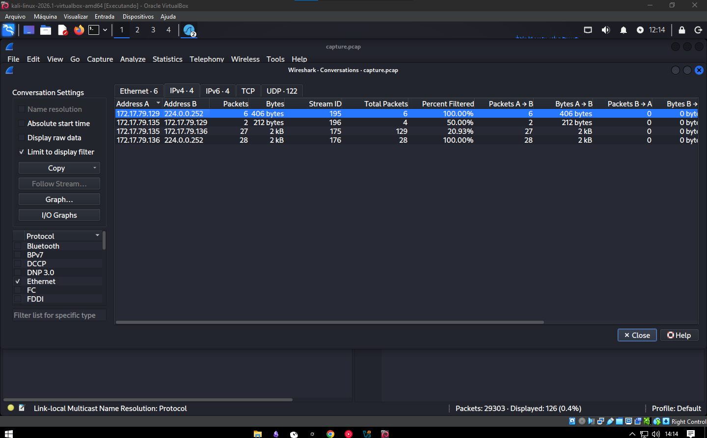

**Resposta:** `172.17.79.135` — o host que responde ao LLMNR e recebe a autenticação SMB.

---

### Hostname da máquina maliciosa

A máquina do atacante pega IP por DHCP. No handshake DHCP (Discover → Request → ACK) existe a **Option (12) Host Name**, que revela o nome do host.

Filtro: `ip.addr == 172.17.79.135 && dhcp`

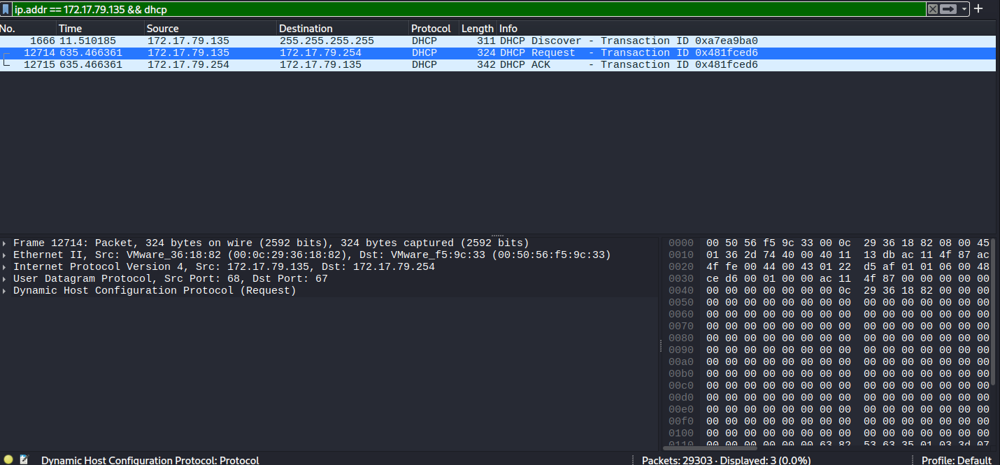

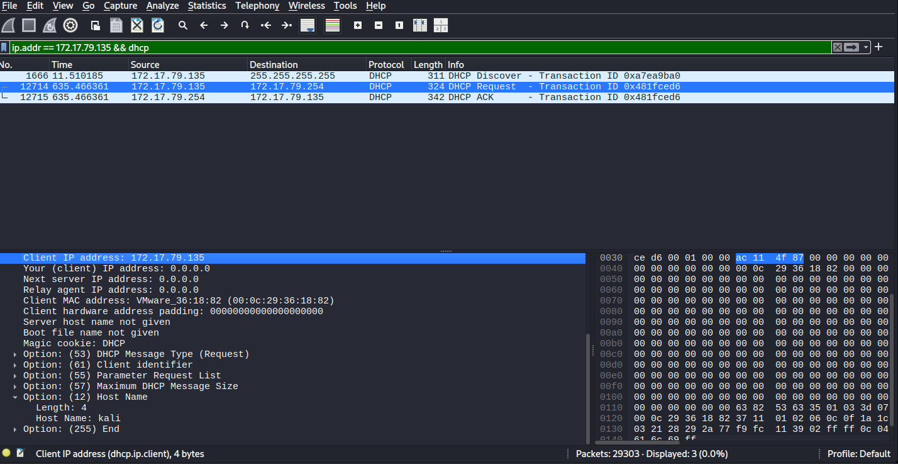

**Resposta:** `kali` — nome clássico de máquina de pentest.

---

## 🧩 A captura do hash (NTLM sobre SMB)

Quando a vítima autentica, o NTLM faz 3 passos dentro do SMB:

| Passo | Tipo NTLMSSP | Filtro | O que carrega |
|---|---|---|---|
| NEGOTIATE | `0x00000001` | `ntlmssp.messagetype == 0x00000001` | Início da negociação |
| CHALLENGE | `0x00000002` | `ntlmssp.messagetype == 0x00000002` | **Server Challenge** (o servidor manda um desafio) |
| AUTH | `0x00000003` | `ntlmssp.messagetype == 0x00000003` | **Usuário + NTProofStr** (a prova/hash) |

### Usuário cujo hash foi capturado

Filtro `ntlmssp` e abrimos o pacote de AUTH. No campo **User Name** aparece o domínio e o usuário.

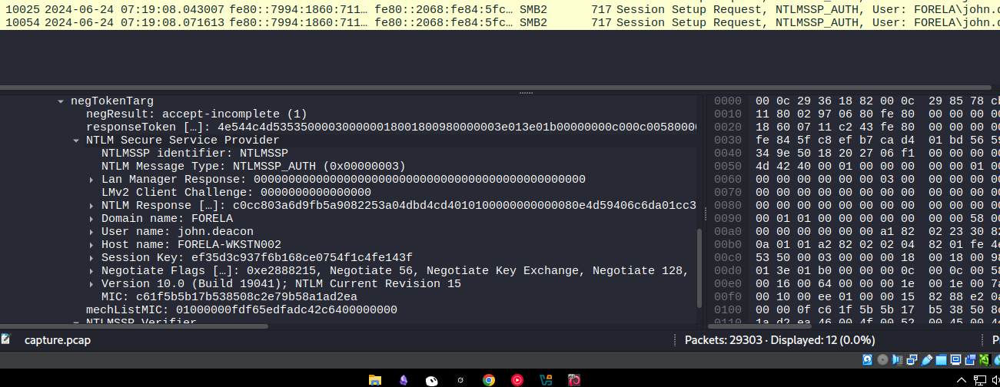

**Resposta:** `john.deacon` (domínio `FORELA`).

---

### Quando o hash foi capturado (horário UTC)

O relatório usa **UTC**, não o horário local (EDT) nem a coluna *Time* (que é "segundos desde o início da captura"). No painel de detalhes do primeiro pacote da troca NTLM, usamos o campo **UTC Arrival Time** (Frame).

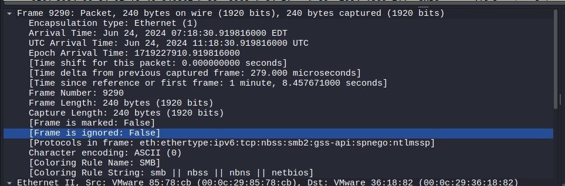

**Resposta:** `2024-06-24 11:18:30` (UTC).

> 💡 Cuidado: a HTB conta o **início da troca NTLM** (o primeiro pacote `ntlmssp`, um NEGOTIATE de 240 bytes — frame 9290), não o primeiro `AUTH`.

---

### A query LLMNR que começou tudo (erro de digitação)

Filtro `llmnr`. A primeira query mostra o nome que a vítima tentou acessar e não existe.

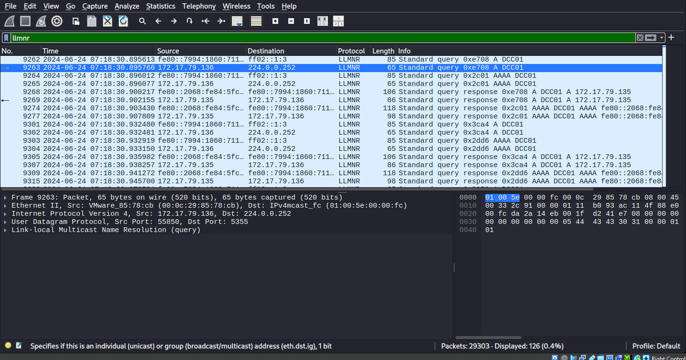

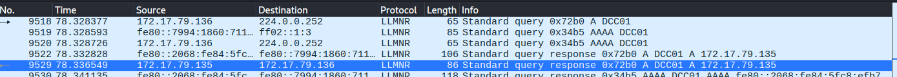

**Resposta:** a vítima digitou `DCC01` (em vez de `DC01`).

> 💡 "Query" aqui = **pergunta** ("alguém conhece esse nome?"). O valor hexadecimal ao lado (ex.: `0xe708`) é o **Transaction ID** da query, não um índice.

---

### NTLM Server Challenge

Filtro `ntlmssp.messagetype == 0x00000002` (só os CHALLENGE). No pacote, o campo **NTLM Server Challenge** (`ntlmssp.ntlmserverchallenge`) é o desafio de 8 bytes que o "servidor" (atacante) manda.

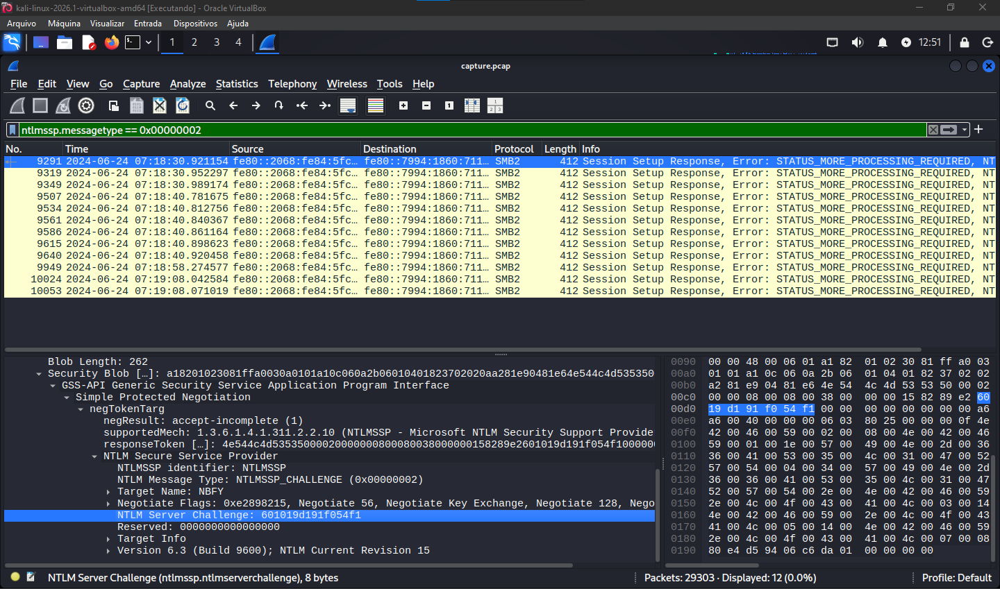

**Resposta:** `601019d191f054f1`.

---

### NTProofStr

Filtro `ntlmssp.messagetype == 0x00000003` (os AUTH). Abrimos a **NTLMv2 Response** → campo **NTProofStr** (os primeiros 32 hex da resposta NTLMv2).

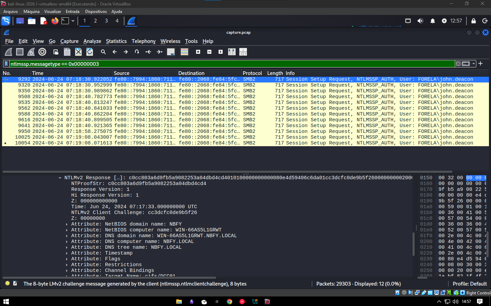

**Resposta (NTProofStr):** `c0cc803a6d9fb5a9082253a04dbd4cd4`.

---

## 🔓 Quebrando o hash (hashcat)

O NTLMv2 usa o modo **5600 (NetNTLMv2)** do hashcat. O formato do hash montado é:

```
usuario::DOMINIO:ServerChallenge:NTProofStr:resto_da_NTLMv2Response
```

Ou seja:

```
john.deacon::FORELA:601019d191f054f1:<NTProofStr>:<resto começando em 01010000...>
```

Comando:

```bash
hashcat -m 5600 hash.txt /usr/share/wordlists/rockyou.txt
```

> 🛡️ **Lição de depuração:** se o `hash.txt` tiver só a resposta NTLMv2 crua (sem o prefixo `john.deacon::FORELA:challenge:NTProofStr:`), o hashcat termina com **Status: Exhausted / Recovered 0/1** — ele "roda" mas não quebra, porque o hash está mal formado.

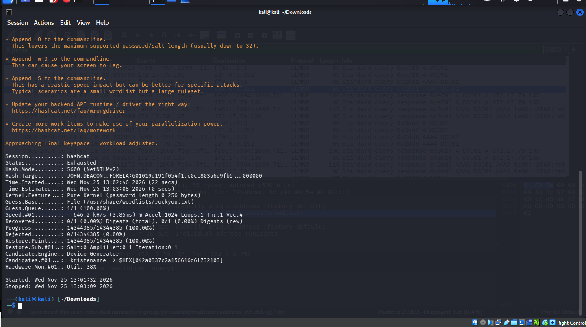

Com a linha completa e correta, o hashcat quebra em segundos:

```
Status...........: Cracked
Hash.Mode........: 5600 (NetNTLMv2)
john.deacon::FORELA:601019d191f054f1:...:...:NotMyPassword0k?
```

> 💡 `hashcat --show` só exibe hashes **já quebrados** no potfile; na primeira vez, rode **sem** `--show`.

**Resposta (senha):** `NotMyPassword0k?`

---

### Compartilhamento que a vítima tentou acessar

Filtro `smb2.cmd == 3` (Tree Connect). Atenção: `\\DC01\IPC$` é o canal administrativo padrão — **não** é a resposta. O compartilhamento real está em outro Tree Connect.

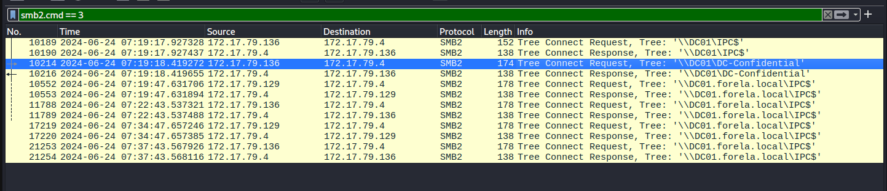

**Resposta:** `\\DC01\DC-Confidential`.

---

## 📋 Respostas (resumo)

| # | Pergunta | Resposta |
|---|---|---|
| 1 | IP da máquina maliciosa | `172.17.79.135` |
| 2 | Hostname da máquina maliciosa | `kali` |
| 3 | Usuário cujo hash foi capturado | `john.deacon` |
| 4 | Horário (UTC) da captura do hash | `2024-06-24 11:18:30` |
| 5 | Nome digitado errado (query LLMNR) | `DCC01` |
| 6 | NTLM Server Challenge | `601019d191f054f1` |
| 7 | NTProofStr | `c0cc803a6d9fb5a9082253a04dbd4cd4` |
| 8 | Senha quebrada | `NotMyPassword0k?` |
| 9 | Compartilhamento acessado | `\\DC01\DC-Confidential` |

---

## 🛡️ Remediação (defesa Blue Team)

- **Desligar LLMNR e NBT-NS** via GPO (`Turn OFF Multicast Name Resolution`) — remove o "plano B" que o ataque abusa.
- **Exigir SMB Signing** — impede retransmissão (relay) dos hashes.
- **Senhas fortes e aleatórias** — se o hash vazar, não quebra na wordlist.
- **Segmentação de rede / NAC** — limita quem consegue responder multicast na mesma VLAN.
- **Detecção no SIEM** — alertar respostas LLMNR anômalas e múltiplas autenticações NTLM falhas.

---

## 🧠 Lições aprendidas

- Um simples **erro de digitação** (`DCC01`) abre a porta: DNS falha → LLMNR → Responder → hash.
- Sempre reporte horários em **UTC**, e saiba a diferença entre `Arrival Time` (EDT), `UTC Arrival Time` e a coluna `Time` (segundos relativos).
- No NTLMv2: **CHALLENGE = 0x02** (server challenge), **AUTH = 0x03** (usuário + NTProofStr). O hash do hashcat junta os dois.
- `IPC$` é ruído administrativo; o compartilhamento "de verdade" estava em outro Tree Connect.

---

## ❓ Pergunta pra fixar

Se a Forela tivesse **SMB Signing obrigatório** mas **mantivesse o LLMNR ligado**, o atacante ainda conseguiria o hash NTLMv2 do `john.deacon`? O que mudaria no que ele consegue fazer depois de capturá-lo?
